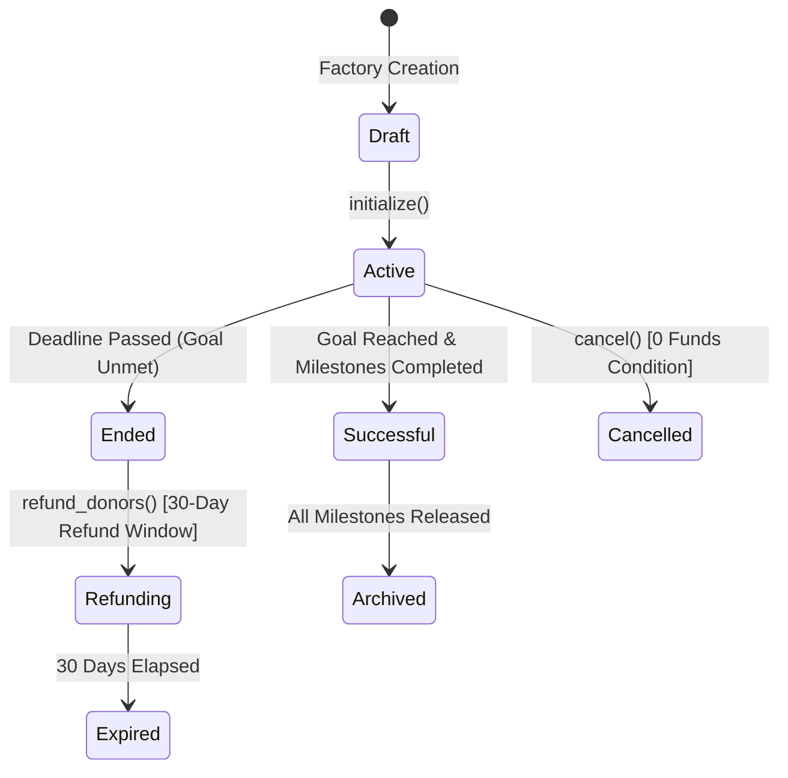
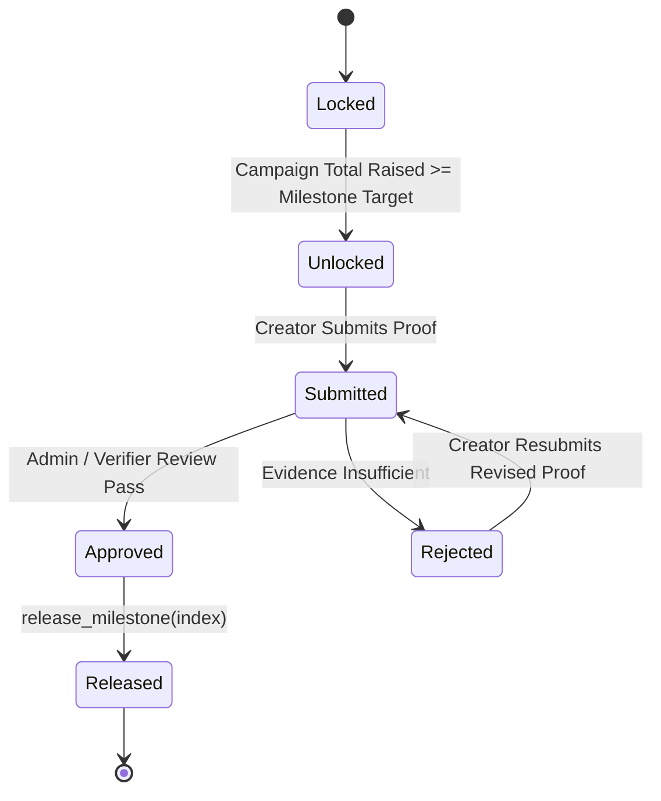

# Lumora Campaign Contract Architecture & Formal Verification Invariants

/* Authorized Protocol Quality Assurance & Formal Verification Test Suite */

## 1. Overview
The Lumora Campaign Smart Contract is a decentralized crowdfunding and milestone-based grant distribution protocol built on Soroban (Stellar Smart Contracts). It provides multi-asset fundraising, staged milestone verification, mathematical release accounting, and guaranteed donor refund mechanisms.

---

## 2. Campaign Lifecycle State Machine

The campaign transitions across deterministic states governed by time, funding thresholds, and administrator/community actions:

### State Definitions
- **Draft**: Instantiated contract before `initialize()` is executed. Rejects all financial operations with `Error::NotInitialized`.
- **Active**: Accepting contributions in whitelisted assets. Milestones can be verified and unlocked.
- **Successful**: Goal reached or all milestones approved. Funds released sequentially according to approved milestone tranches.
- **Ended**: Campaign reached `end_time` without reaching goal or completing milestones. Activates 30-day donor refund window.
- **Cancelled**: Aborted by campaign admin prior to fund intake, or after complete donor restitution.
- **Archived**: Complete lifecycle termination. Persistent storage retained for historical auditing.

---

## 3. Milestone State Machine & Release Ordering

Each campaign defines $M \le 5$ milestones with monotonically increasing funding targets.

### Milestone Invariants
1. **Strict Monotonicity**: For all milestones $i < j$, `target_amount[i] < target_amount[j]`.
2. **Terminal Equivalence**: The final milestone target must equal the campaign funding goal.
3. **Sequential Release Gate**: Milestone $N$ can ONLY be released if milestone $N-1$ has already achieved `MilestoneStatus::Released` (`Error::PreviousMilestoneNotReleased`).

---

## 4. Financial Guarantees & Precision Calculations

### Multi-Asset Intake & Conservation Invariant
Campaigns accept a specified whitelist of assets (`accepted_assets`). For every accepted asset $A$:
$$\text{ContractBalance}(A) = \sum \text{Donations}(A) - \sum \text{Released}(A) - \sum \text{Refunded}(A)$$

### Proportional Milestone Release
When milestone $k$ with allocation fraction $f_k \in (0, 1]$ is approved, the release amount for each asset $A$ is calculated using integer division with truncated remainder protection:
$$\text{ReleaseAmount}(A, k) = \frac{\text{TotalCollected}(A) \times \text{MilestoneAllocationBps}(k)}{10,000}$$
- Checked arithmetic (`validate_mul`, `validate_div`) prevents 128-bit integer overflows.
- Truncated fractional dust remains within the contract balance and is accounted for in final milestone closeout.

### Non-Reentrancy Guard
All financial transfer functions (`donate`, `release_milestone`, `refund`) invoke reentrancy locks before interacting with external Stellar asset contracts (`soroban_sdk::token::Client`). Reentrant re-entry reverts immediately with `Error::Reentrant`.

---

## 5. Storage Strategy & TTL Architecture

Soroban storage tiers are strictly partitioned according to lifetime and failure impact:

| Storage Type | Keys Stored | Rationale | TTL Policy |
| :--- | :--- | :--- | :--- |
| **Persistent Storage** | Campaign Config, Admin Address, Accepted Assets List, Milestones Vector, Total Raised Accounting, Donor Ledgers | Critical contract invariants and audit records that must never be purged during or after campaign lifecycle. | Extended via `env.storage().persistent().extend_ttl()` on every state mutation. |
| **Instance Storage** | Contract-level metadata, initialization flag, reentrancy mutex flag | Tied to contract instance life. Ensures instance availability. | Bumped on every public entry point. |
| **Temporary Storage** | Transient calculation caches, ephemeral batch indices | Data that is only relevant during single-transaction execution or short-lived phases. | Allowed to expire without risking fund safety. |

---

## 6. Safety Invariants Catalog

| Invariant ID | Formal Guarantee | Enforcement Mechanism |
| :--- | :--- | :--- |
| **INV-01: Zero Pre-Init Interaction** | No balance or state can be altered prior to valid initialization. | `check_not_already_initialized()` check on all mutation paths. |
| **INV-02: Single Initialization** | `initialize()` can execute exactly once per contract instance. | Persistent `INITIALIZED` key check; reverts with `Error::AlreadyInitialized`. |
| **INV-03: Whitelist Asset Strictness** | Unapproved assets cannot be transferred into or held by the contract. | `is_asset_accepted()` lookup; reverts with `Error::AssetNotAccepted`. |
| **INV-04: Non-Decreasing Progress** | Total funds collected is strictly monotonically non-decreasing during `Active` state. | Cumulative accounting via checked additions (`validate_add`). |
| **INV-05: Non-Replayable Refunds** | A donor cannot claim a refund more than once. | Donor ledger record is zeroed out atomically before external token transfer. |
| **INV-06: Refund Window Enforcement** | Refunds are permitted strictly within 30 days post campaign deadline. | `current_time <= end_time + REFUND_WINDOW`; reverts with `Error::RefundWindowClosed`. |

---

## 7. Operational Runbooks & Recovery Procedures

### 1. Incomplete or Interrupted Milestone Release
- **Symptom**: Transaction timeout or gas exhaustion during multi-asset milestone release.
- **Recovery Path**: Milestone status remains in `Approved` state until the final asset transfer completes. Re-invoking `release_milestone(index)` safely resumes the transfer without double-debiting previously released assets due to idempotent per-asset release tallies.

### 2. State Desynchronization / Horizon Indexer Lag
- **Symptom**: Off-chain indexer shows discrepancy with on-chain balance.
- **Recovery Path**: On-chain storage is the canonical single source of truth. Invoke read-only queries `get_campaign_info()` and `get_milestone(index)` to resynchronize the off-chain Postgres cache.

### 3. Persistent Storage TTL Restoration
- **Symptom**: Contract approaches archival state due to inactivity.
- **Recovery Path**: Anyone (permissionless) or the campaign admin can invoke `bump_ttl()` to extend persistent keys by `172,800` ledgers (~30 days).
